# 万物收纳（Nook）

把家搬进手机：先像搭积木一样画出房间、摆好家具，之后打开任何一个柜子、抽屉、冰箱、洗碗机，就能看到并管理里面放了什么。

| 户型图 | 房间布置 | 打开冰箱 | 物品详情 |
| :---: | :---: | :---: | :---: |
| 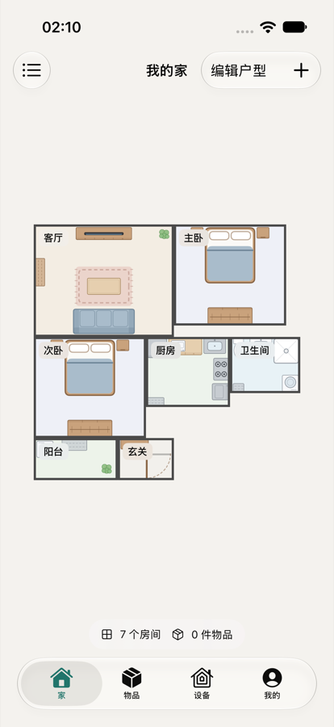 | 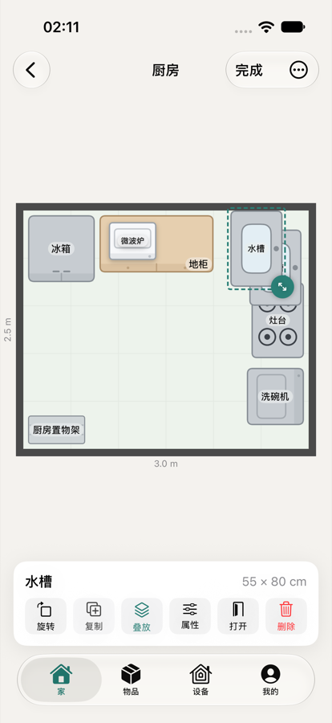 | 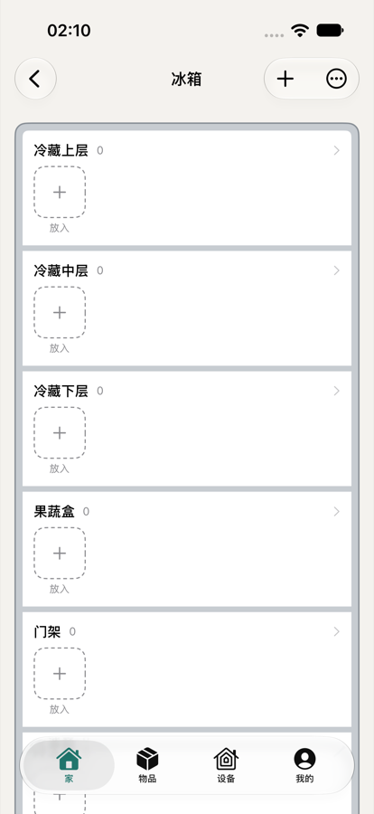 | 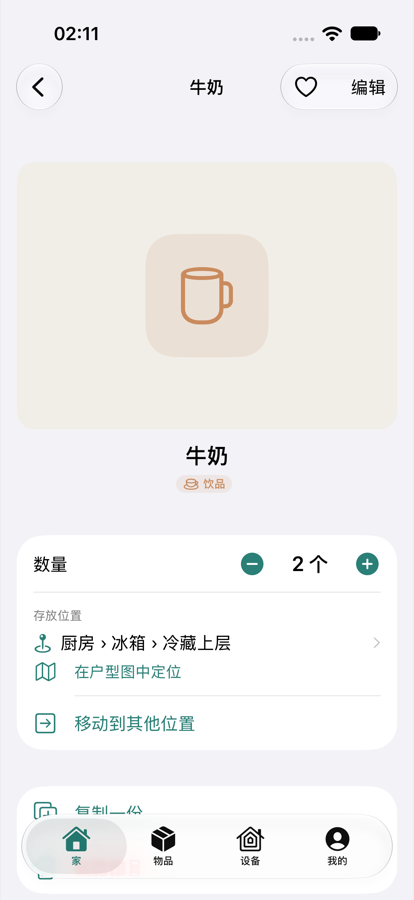 |
| **录入物品** | **物品总表** | **HA 设备** | **设备开着时家具发光** |
| 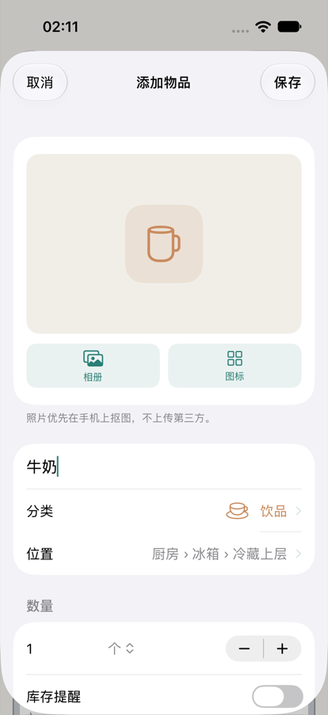 | 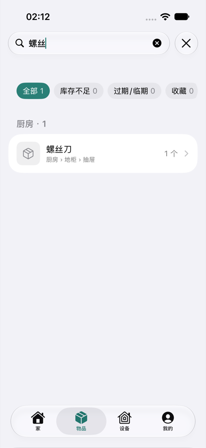 | 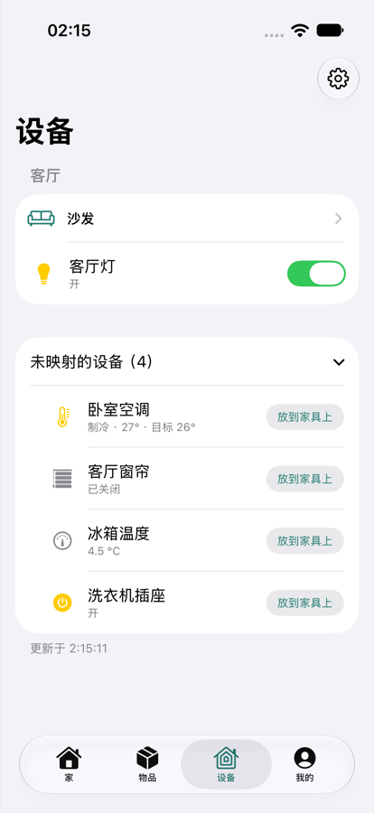 | 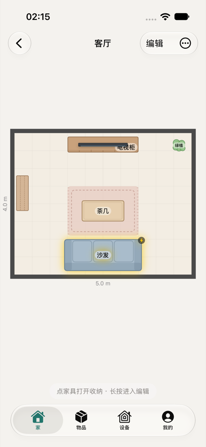 |

Android 版功能和 iOS 一致，数据通过同一个账号互通：

| Android 户型图 | 房间编辑 | 冰箱里的物品 | 离线抠图（U²-Net-p） |
| :---: | :---: | :---: | :---: |
| 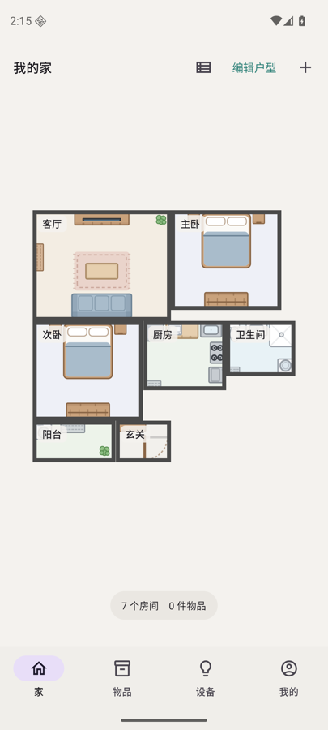 | 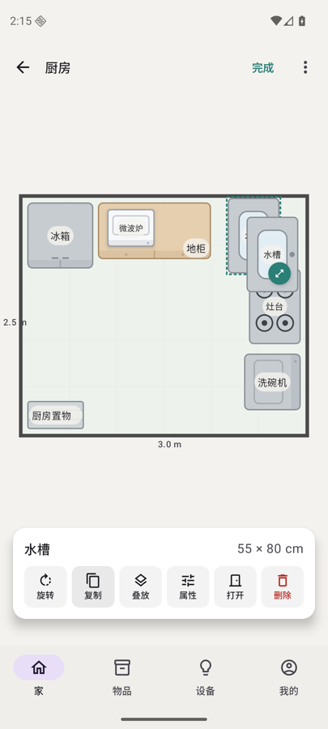 | 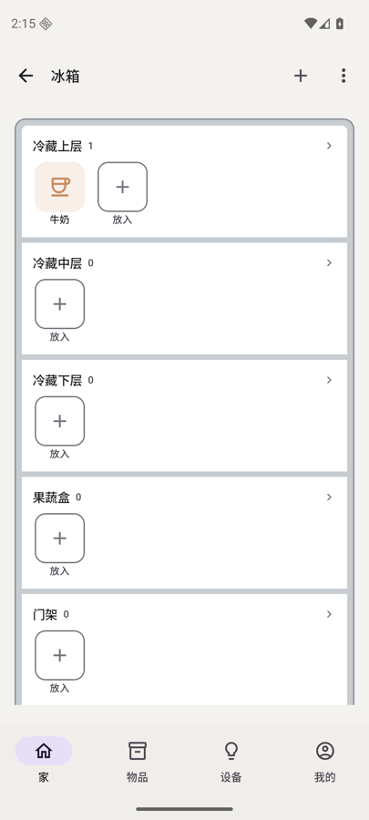 |  |

```
Nook/
├── ios/        iOS 客户端（SwiftUI，iOS 18+）
├── android/    Android 客户端（Jetpack Compose，Android 9+）
├── server/     同步服务端（FastAPI + SQLite，Docker 部署）
└── tools/      测试工具（模拟 Home Assistant、模拟 Claude 接口）
```

## 功能

| 模块 | 能做什么 |
| --- | --- |
| 户型搭建 | 首次启动选房间类型和数量，可自动摆放常见家具；户型图里拖动房间、拖右下角改尺寸，房间边缘会自动吸附对齐 |
| 房间布置 | 55 种家具（卧室、客厅、厨房、卫浴、书房、收纳、门窗墙柱）加自定义家具；可拖动、旋转、缩放、复制、删除；支持**叠放**（微波炉放在地柜上、烘干机叠在洗衣机上），叠放的家具跟着底下的一起移动和旋转 |
| 打开家具 | 柜门打开的动画，每个收纳位（层、抽屉、挂衣区、冷冻室、碗篮……）显示成一层，直接往里放东西；收纳位可以增删、改名、排序 |
| 物品 | 拍照或从相册选图，**端侧抠图**（iOS 用 Apple Vision；Android 先用 ML Kit，不可用时用内置的离线模型 U²-Net-p，国内没有 Google 服务的手机也能用；多主体时可选保留哪些），失败时可交给服务器抠图；不用照片时可选图标库（中文搜索）、Emoji，或用 **AI 画图标**；分类分三种模板：通用 / 衣物（颜色、季节、穿着记录、单次穿着成本）/ 消耗品（保质期、库存提醒） |
| 物品总表 | 按位置、分类、最近更新分组；搜索名称、标签、备注、位置；筛选库存不足、临期、收藏、未归位；左滑 ±1、移动、删除；能在户型图里定位到对应家具 |
| 智能家居 | 连接内网 Home Assistant，把灯、空调、窗帘、洗衣机插座等实体映射到家具上，直接开关和调温；设备开着的家具在平面图上会发光 |
| 同步 | 一个账号多台设备，**iPhone 和安卓手机共用一份数据**；离线可用，联网后自动增量同步；照片单独上传 |
| 离线模式 | **完全不需要服务器也能用**：不登录就是本机模式；登录后可以随时打开“离线模式”暂停一切服务器通信；AI 画图标可改用本机直连（自己的 Key）；用 zip 备份在设备之间、iPhone 和安卓之间搬家 |

所有"新建"都有对应的编辑和删除。删除房间、家具或收纳位时，会问你物品是"移到未归位"还是"一起删除"。在另一台设备上被删掉的内容，会显示"已删除"提示，不会出现空白页。

## 离线模式（不依赖服务器）

服务端是可选的。两端 App 不连任何服务器也能完整使用：

- **本机模式**：首次打开直接“开始搭建我的家”，不登录。所有数据和照片只存在这台设备上，户型、收纳、拍照抠图、物品管理、Home Assistant 控制都能用。HA 本来就是由手机直接连接的，不经过服务端。
- **离线开关**：已经登录同步的设备，在“我的 › 账号与同步”里打开“离线模式”后，App 完全不连服务器，改动先存在本机（显示“已暂停 · N 项改动待同步”），关闭后自动补上同步。适合 NAS 在家、出门连不上的情况。
- **AI 画图标**：在“我的 › AI 绘制图标”里选“本机直连”，填自己的 Claude API Key（可选填代理地址和模型）。Key 只保存在这台设备上（iOS 钥匙串、Android Keystore 加密），不会同步。“检查并保存”只读取模型列表，不消耗额度。
- **备份与恢复**：“我的 › 备份”导出一个 zip 文件（包含全部数据和照片，不含 HA 令牌），可以存到文件、网盘或电脑。恢复时可以选“合并”（每条记录保留较新的一份）或“替换本机数据”。iOS 和安卓的备份可以互相恢复。新设备在欢迎页就能直接“从备份恢复”。

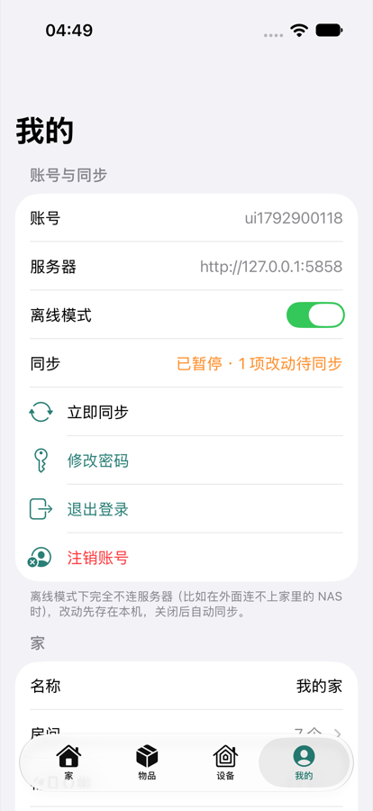 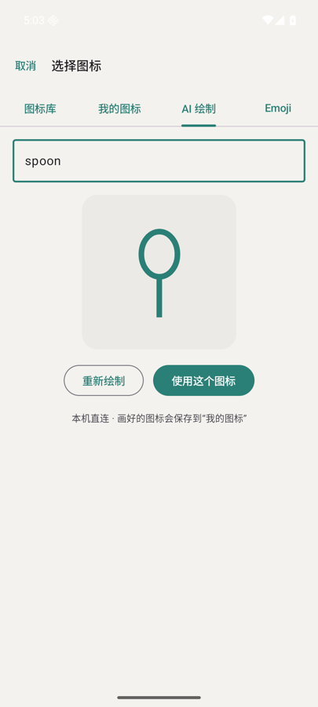

## 1. 部署服务端（可选）

两种部署方式，选一种：

**家里局域网（NAS / 家用服务器，推荐）**：只在家里的网络里能访问，出门时客户端自动排队、回家后同步。

```bash
cd server
cp .env.example .env        # 按需修改
docker compose up -d --build
docker logs nook-server     # 找到“注册码 XXXX-XXXX-XXXX-XXXX”，注册第一个账号时填
```

客户端里服务器地址填 `NAS的IP:5858`。

**公网（VPS，或者 NAS 做了端口转发）**：自带 Caddy，自动申请 Let's Encrypt 证书，只开放 80/443。Nook 容器本身不暴露任何端口。

```bash
cd server
cp .env.example .env        # 必填 NOOK_DOMAIN（解析到这台机器的域名）；要给家人注册就填 NOOK_INVITE_CODE
docker compose -f docker-compose.public.yml up -d --build
docker logs nook-server     # 第一个账号的注册码
```

客户端里服务器地址填 `https://你的域名`。

- 数据在 Docker 卷 `nook-data` 里（SQLite 加照片文件），备份这个卷即可。如果从旧备份恢复，客户端会检测到并自动重新上传本机数据。
- **注册**：默认谁都不能注册。刚部署的服务器会在日志和 `/data/setup-code` 里给出一次性注册码，用它注册的第一个账号就是主人，之后这个码作废。想让家人也注册，在 `.env` 里设 `NOOK_INVITE_CODE`（至少 8 位），把它告诉家人。`NOOK_ALLOW_REGISTRATION=true` 会让任何人都能注册，不要在公网上用。
- **AI 画图标**：在 `.env` 填 `ANTHROPIC_API_KEY`，默认用 `claude-opus-5-5`。走代理或网关时设置 `ANTHROPIC_BASE_URL`；如果网关不支持 beta 请求头，把 `NOOK_ICON_FALLBACKS` 设成 `false`。Key 只放在服务器上，手机里没有。每个账号每小时 60 次、全服务器每天 300 次，防止 Key 被刷。
- **服务器抠图兜底**（可选）：`.env` 里设 `WITH_CUTOUT=true` 后重新构建。镜像会大约 400 MB，第一次抠图时会下载模型。
- 依赖装的是 `requirements.lock` 里带哈希的固定版本。升级依赖时改 `requirements.txt`，再用 `pip-compile --generate-hashes --allow-unsafe --strip-extras` 重新生成两个 `.lock` 文件。

### 安全加固

服务端按“会被放到公网上”来设计。下面这些默认都开着：

| 风险 | 怎么防 |
| --- | --- |
| 新部署被别人抢先注册 | 默认关闭注册；第一个账号要用日志里的一次性注册码；家人用邀请码；账号数量有上限（`NOOK_MAX_USERS`） |
| 暴力破解、撞库 | 同一 IP 对同一账号失败 5 次锁 15 分钟；同一 IP 失败 20 次（换着用户名试）锁 15 分钟；同一账号每小时最多失败 50 次（分布式爆破）；注册码猜错 10 次锁 1 小时；修改密码和注销账号要重新输入密码，也一样限速。已经登录的设备不受锁定影响 |
| 通过时间差判断账号是否存在 | 用户名不存在时也做同样的密码哈希；注册时先验注册码，再检查用户名是否被占用 |
| 伪造 `X-Forwarded-For` 绕过限速 | 只相信 `FORWARDED_ALLOW_IPS` 里的反向代理（公网方案里只有 Caddy 的固定内网 IP）；Caddy 会丢掉客户端自带的这个头 |
| 明文传输被窃听 | 公网方案强制 HTTPS（`NOOK_REQUIRE_HTTPS`），带 HSTS；客户端填了公网的 `http://` 地址会提醒 |
| 令牌泄露后长期有效 | 只存令牌的 SHA-256；90 天不用自动失效；每个账号最多 30 个登录设备；改密码会让其他设备全部下线 |
| 大请求耗尽内存、磁盘 | 每个接口单独限制请求体大小（流式上传也会中途截断）；每个账号默认 4 GB 存储、20 万条记录的配额；scrypt 同时最多 4 个，服务器抠图一次一个，并拒绝超大像素的图片 |
| 上传伪装文件（HTML 冒充图片等） | 按文件头识别类型，只接收 JPEG / PNG / HEIC / WebP，以识别出的类型保存和返回；响应带 `nosniff` 和 `sandbox` 的 CSP |
| 信息泄露 | 关闭 `/docs`、`/openapi.json`；不返回 `Server` 头；错误信息里没有内部细节；Caddy 只转发 `/api/*` |
| 服务器被攻破后的影响 | 容器以非 root 用户运行，根文件系统只读，去掉全部 Linux capabilities，禁止提权，限制进程数和内存；Caddy 管理接口关闭。**Home Assistant 令牌不再上传到服务器**，只保存在各自设备的钥匙串 / Keystore 里，服务器被攻破也拿不到你家的设备控制权 |
| 审计 | 登录成功和失败、被限速、注册、改密码、注销都会记录用户名和 IP，用 `docker logs nook-server` 查看，也可以接 fail2ban |

部署时你自己还要做的：VPS 上只放行 22/80/443，SSH 用密钥登录；定期 `docker compose pull && docker compose up -d --build` 更新基础镜像；定期备份 `nook-data` 卷。

接口一览：`/api/info`、`/api/auth/{register,login,logout,password}`、`/api/me`、`/api/me/delete`、`/api/sync`、`/api/files/{id}`、`/api/icons/generate`、`/api/cutout`。

## 2. 运行 iOS 客户端

需要 Xcode 16 以上，以及 [XcodeGen](https://github.com/yonaskolb/XcodeGen)。

```bash
cd ios
xcodegen generate
open Nook.xcodeproj
```

在 Xcode 里选一个模拟器或真机运行。真机需要在 Signing 里选你自己的开发者账号。第一次打开会进入"搭建你的家"；要同步的话，在"我的 › 登录或注册"里填服务器地址（例如 `192.168.1.10:5858`，公网部署填 `https://你的域名`）。注册新账号时要填注册码（见上面的“注册”）。

同一个 App 同时支持 iPhone 和 iPad。iPhone 固定竖屏；iPad 横竖屏都可以，也支持分屏和侧拉。在 iPad 上，标签栏在顶部，户型图和房间平面图会用满整个屏幕，悬浮的操作面板保持卡片宽度，打开的家具左边是柜子、右边是详情，设置和列表页限制在适合阅读的宽度。

| iPad 横屏：户型图 | 房间编辑 | 打开冰箱 |
| :---: | :---: | :---: |
| 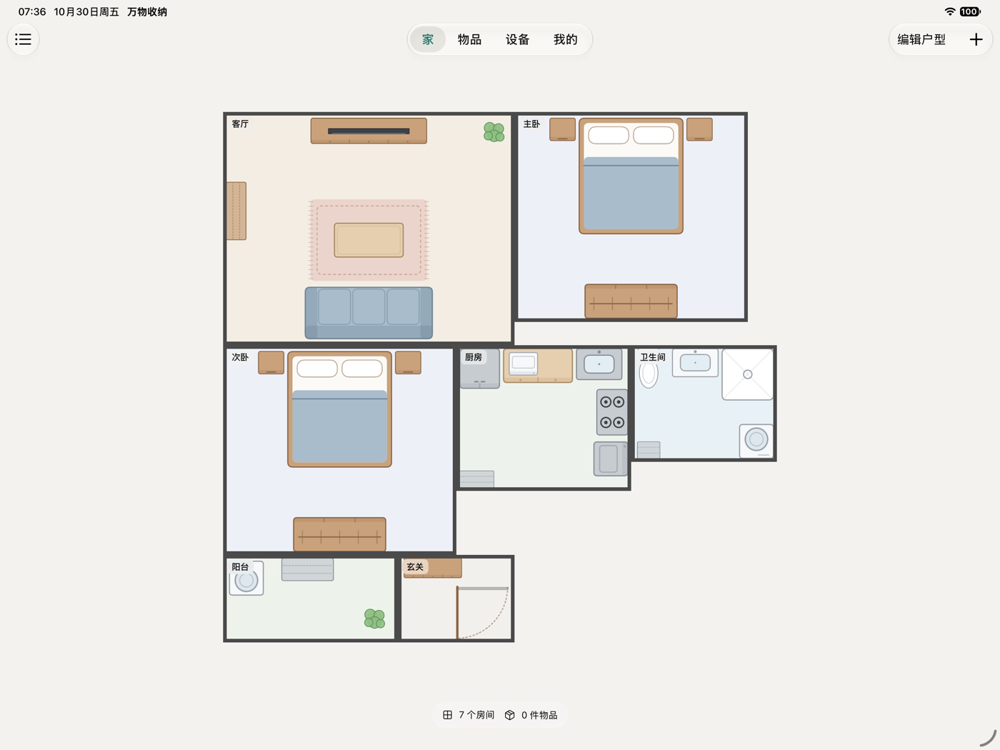 | 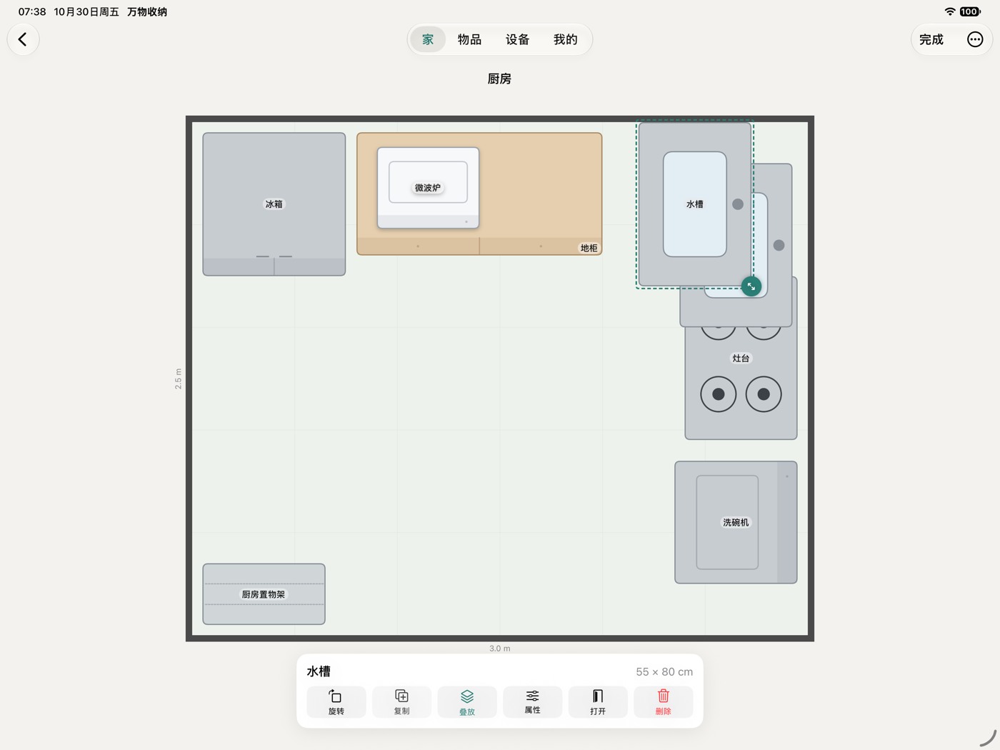 | 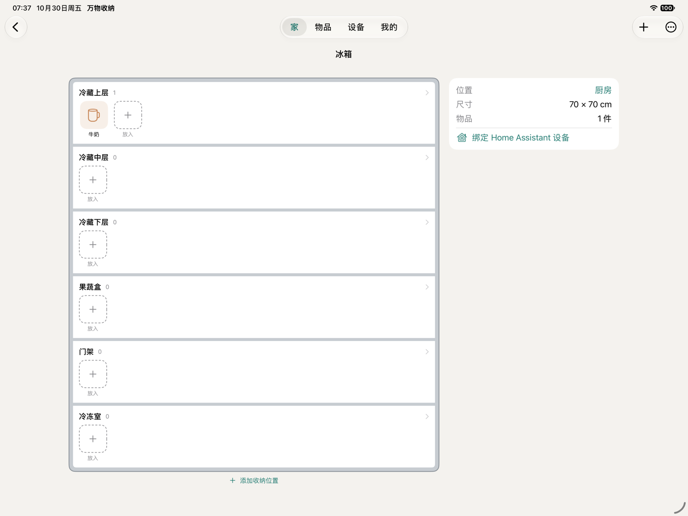 |

## 3. 运行 Android 客户端

需要 JDK 17 和 Android SDK（API 36）。用 Android Studio 打开 `android/` 目录直接运行即可，或者用命令行：

```bash
cd android
./gradlew :app:assembleDebug                 # 输出 app/build/outputs/apk/debug/app-debug.apk
adb install -r app/build/outputs/apk/debug/app-debug.apk
```

- 正式包：`./gradlew :app:assembleRelease` 会生成**未签名**的 APK（经 R8 压缩后约 58 MB，包含 arm64 和 x86_64 两种架构，其中离线抠图的运行库和 Claude SDK 占了大头）。发布前需要用你自己的签名密钥签名。上架应用商店建议用 AAB，商店会按 CPU 架构拆分，下载体积会更小。
- 模拟器里访问电脑上的服务端，地址填 `10.0.2.2:5858`；真机填电脑的局域网 IP。

**Home Assistant**：在"设备"页或"我的 › Home Assistant"里，填写 HA 地址（例如 `http://192.168.1.20:8123`）和长期访问令牌。令牌在 HA 网页里生成：头像 › 安全 › 长期访问令牌。地址会随账号同步；令牌只保存在这台设备上（钥匙串 / Keystore 加密），不会上传到服务器，每台设备各填一次。旧版本同步过的令牌，升级后会自动移到本机，并把服务器上的那份清掉。

## 4. 测试

```bash
# 服务端：账号、同步冲突、分页、文件隔离、AI 图标安全过滤，以及上面的各项加固
cd server && docker run --rm -v "$PWD":/srv -w /srv python:3.12-slim \
  sh -c "pip install -q -r requirements.txt -r requirements-dev.txt && python -m pytest -q -p no:cacheprovider"
```

- 加固相关的测试会单独启动真实的 uvicorn 进程，验证一次性注册码、伪造的 `X-Forwarded-For` 不起作用、HTTPS 强制和 HSTS、配置不安全时拒绝启动。
- 客户端测试需要服务端允许测试账号注册。用测试用的邀请码 `nook-test-invite` 启动（或用 `NOOK_INVITE` / `TEST_RUNNER_NOOK_INVITE` 改成你自己的）：

```bash
cd server && printf 'services:\n  nook:\n    environment:\n      NOOK_INVITE_CODE: nook-test-invite\n' > /tmp/nook-test.yml
docker compose -f docker-compose.yml -f /tmp/nook-test.yml up -d --build
```

```bash
# iOS：单元测试 + UI 测试（需要服务端在 127.0.0.1:5858 运行）
cd ios && xcodebuild -project Nook.xcodeproj -scheme Nook \
  -destination 'platform=iOS Simulator,name=iPhone 17' test
```

- 单元测试覆盖：SVG 解析、户型预设、叠放的移动和旋转、删除策略、持久化、同步冲突合并、孤儿数据修复、端侧抠图，以及**两台设备通过真实服务器同步**。
- UI 测试走完整流程：建家 → 打开冰箱 → 放入、编辑、删除物品 → 改布局 → 总表搜索 → 注册并同步 → 换一台"新设备"登录，数据恢复 → 注销账号。
- HA 的 UI 测试需要先运行 `python3 tools/fake_ha.py 18123`，没运行会自动跳过。
- 离线模式相关：备份往返（合并 / 替换）、拦截恶意文件名（如 `../`）、AI 本机直连。直连测试需要先运行 `python3 tools/fake_claude.py 18200`（模拟 Claude 接口，不花钱），没运行会自动跳过。端到端测试里也包含“打开离线模式 → 加物品 → 关闭后同步 → 另一台设备能看到”。
- iOS 测试要用签了名的包来跑（Xcode 默认的本地签名即可）。没有签名的模拟器包写不进钥匙串。

```bash
# Android：JVM 单元测试 + 模拟器上的端到端测试（服务端在 127.0.0.1:5858，模拟器里是 10.0.2.2:5858）
cd android && ./gradlew :app:testDebugUnitTest :app:connectedDebugAndroidTest
```

- Android 单元测试和 iOS 覆盖同样的逻辑，另外专门测了**和 iOS 的数据格式兼容**：能读 iOS 写的记录（大写 UUID、带小数的毫秒时间），写出的记录 iOS 也能读。
- 端到端测试流程和 iOS 一样，另有离线抠图测试和 HA 测试。
- **跨平台备份测试**：Android 生成一份备份 → iOS 恢复并核对，再生成自己的备份 → Android 恢复并核对：

```bash
X=$(mktemp -d)
(cd android && XPLAT_DIR=$X ./gradlew :app:testDebugUnitTest --tests com.wanwu.nook.OfflineTest --rerun)
(cd ios && TEST_RUNNER_XPLAT_DIR=$X xcodebuild -project Nook.xcodeproj -scheme Nook -destination 'platform=iOS Simulator,name=iPhone 17' -only-testing:NookTests/OfflineTests test)
(cd android && XPLAT_DIR=$X ./gradlew :app:testDebugUnitTest --tests com.wanwu.nook.OfflineTest --rerun)
```

- **跨平台互通测试**：Android 建家并写入物品 → iOS 读出来、核对后再改一些内容 → Android 再读回来核对。用同一个新用户名依次跑三步：

```bash
U=xp$(date +%s)
(cd android && XPLAT_USER=$U XPLAT_PHASE=seed ./gradlew :app:testDebugUnitTest --tests com.wanwu.nook.CrossPlatformTest --rerun)
(cd ios && TEST_RUNNER_XPLAT_USER=$U xcodebuild -project Nook.xcodeproj -scheme Nook -destination 'platform=iOS Simulator,name=iPhone 17' -only-testing:NookTests/CrossPlatformTests test)
(cd android && XPLAT_USER=$U XPLAT_PHASE=verify ./gradlew :app:testDebugUnitTest --tests com.wanwu.nook.CrossPlatformTest --rerun)
```

## 设计说明

- **离线优先**：所有数据先存在本机（`Application Support/Nook/store.json` 和照片文件），每次修改都会记录下来，联网后推送。拉取下来的修改按记录比较时间，较新的一方生效；本机还没推送、又比服务器新的修改会保留，下一轮再推送。删除会以"墓碑"记录同步，离线的设备也能收到。
- **照片**：显示用的是抠好的 PNG，同时保留原图，以后可以重新抠图或切回原图。照片先上传，再推送引用它的记录。
- **AI 图标**：服务器把 Claude 返回的 SVG 按白名单重新生成，只保留 path、circle、rect 这类几何元素。App 里用自己的解析器画成单色矢量图，深色模式下自动变色。
- **两端格式一致**：Android 按 iOS 的记录格式读写（字段名、大写 UUID、毫秒时间戳）。图标统一存成 SF Symbols 的名字，Android 显示时换成对应的 Material 图标，所以在一边选的图标另一边也能显示。Android 的图标库是从 iOS 的代码直接生成的。
- **字段可扩展**：每条记录解码时都能容忍缺少的字段和多出来的字段，以后加字段，旧客户端也不会坏。

## 已知限制

- iOS 的端侧抠图依赖 Vision 的前景分割，**iOS 模拟器不支持**，要在真机上用。同样的调用在 macOS 上测过可以正常抠图。模拟器里会提示失败，或者转给服务器抠图。
- Android 的 ML Kit 抠图需要 Google Play 服务下载模型，国内大多下载不了，这时会自动改用内置的 U²-Net-p（离线，已在模拟器上测过）。U²-Net-p 精度比 ML Kit 低一些，也不能分出多个主体。
- AI 画图标的完整链路是用模拟的 Claude 接口测的（请求格式、模型、回退参数、SVG 过滤）。真正调用 Claude 的效果需要你配置自己的 Key 后试用。
- HA 是用模拟 REST 服务测的，接口按 HA 官方 REST API 实现，还没有接真实的 HA 实例。
- 本机直连模式需要手机能访问 Claude 接口；在国内通常要填一个可用的代理地址。这条链路只用模拟接口测过，真实调用需要你的 Key。
- 目前只有一个"家"、没有楼层，也不能和家人共享（每个账号的数据是独立的）。
